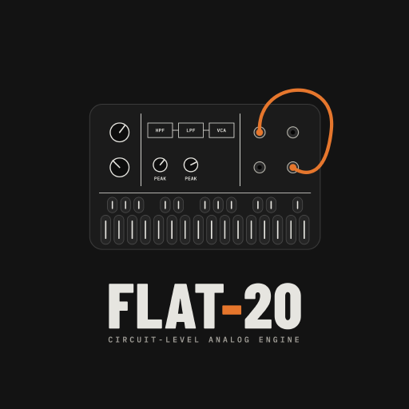
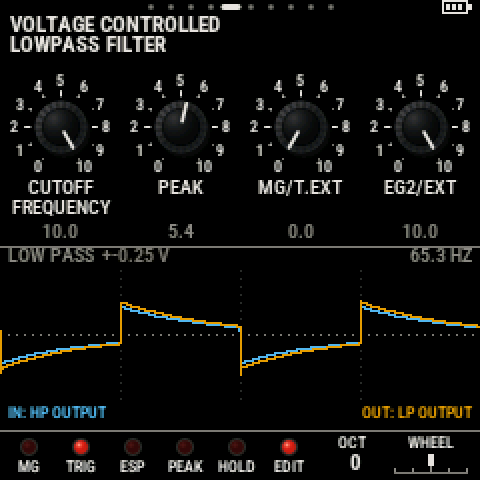
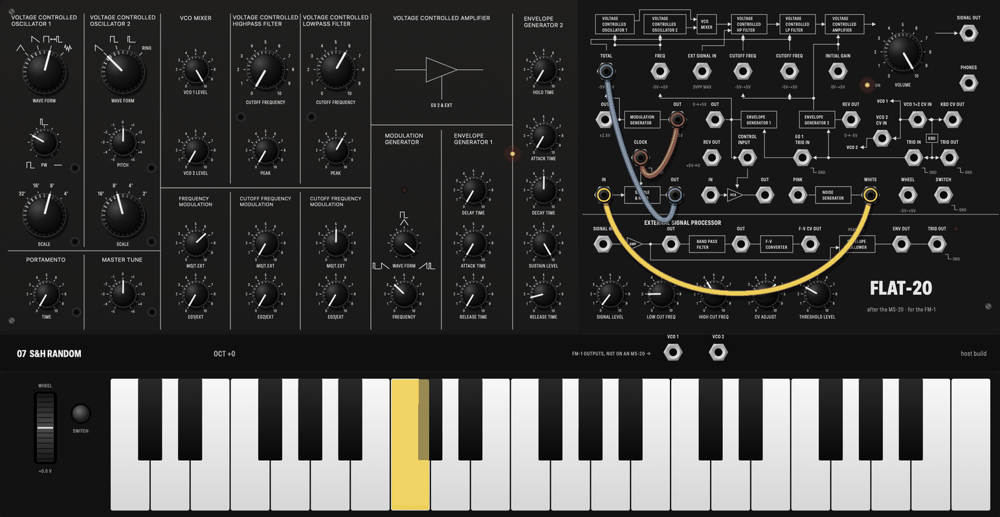

<p align="center"></p>

# FLAT-20

A component-level Korg MS-20 synthesizer firmware for the M-VAVE FM-1, built on [Dinghy](https://github.com/zvenson/dinghy) (GPL-3.0-only; credits in [LICENSING.md](LICENSING.md)). Not affiliated with Korg and contains no Korg code.

<p align="center"></p>

**Status: 0.3.2.** A new screen in the MS-20's panel style: four knobs with their printed scales, a live scope or envelope graph for each page, lamps, a battery gauge and a splash. The keyboard and VCOs now start as a real MS-20 does at power-on, and the VCOs are calibrated as Korg's adjustment procedure calibrates them. 0.2 was tested on hardware: in tune over both USB audio and the built-in speaker, matching the desktop host build across all 16 factory presets, using 56% of the audio ISR budget.

## Overview

FLAT-20 is a circuit-level model of a real analog synthesizer. Its engine (`firmware/src/ms20.h`) is not a sound-alike built by ear: each block is built from the schematic's own parts, and the ones that make the MS-20 sound like itself are solved as circuits, sample by sample. The KORG35 filters run on their diode and transistor equations, solved by Newton's method; the VCA is its one transistor's equation; the envelopes and the MG are their resistor-capacitor networks; the patch panel is solved as electrical nets of source and input resistances, so any two jacks can be joined. The simplest blocks are idealised: the VCO cores are exact ramps driven by the circuit's currents. A companion macOS app shows the whole front panel live and patches it with the mouse.

The engine models the original MS-20 board set (KLM-127 with dual KORG35 filters, KLM-128, and KLM-129) directly from the Korg service manual schematics. Every sound-shaping resistor and capacitor is referenced by its part designator in the code and documented in [docs/MS20-CIRCUIT.md](docs/MS20-CIRCUIT.md). The few values that cannot be read off a schematic (internal KORG35 transistor ratio, audio-taper pot curve, etc.) are taken from hardware recordings or standard component specs and marked accordingly.

Key MS-20 behaviors that are faithfully modeled:

- **Hz/V pitch.** KBD CV OUT outputs 1 V at the lowest C and 8 V at the highest. `VCO 1+2 CV IN` and `VCO 2 CV IN` are linear (doubling voltage doubles frequency; 0 V stops the oscillator). Only the two FM knobs, `MASTER TUNE`, and `PITCH` are exponential. EG1 is normalled to the VCOs at -5 V at rest, so raising `EG1 / EXT` makes notes sweep up into pitch.
- **Switch triggers (S-trigger).** Triggers idle at +5 V and pull to ground when active. Patching the MG rectangle into `TRIG IN` fires while the wave is *low*. The momentary switch is simply a contact to ground.
- **KORG35 filters.** Each filter is a Sallen-Key pair with unequal capacitors feeding a 58x amplifier with two clipping diodes in the feedback loop. Because the diodes sit directly in the signal path, signals saturate gently (more so with both VCOs turned up), and self-oscillation amplitude is limited by the diodes. The high-pass filter is 6 dB/octave. Signal voltage modulates the KORG35's internal transistor resistance, producing asymmetric resonance.
- **EG2 filter offset.** EG2 is sent to the filters with the `SUSTAIN` voltage subtracted (`EG2 - SUSTAIN`). With `SUSTAIN` turned up, `CUTOFF` sets the filter frequency while a key is held, and the filter sits *below* that frequency before and after the note. `REV OUT` is the inverse (`SUSTAIN - EG2`).
- **Single-transistor VCA.** Closed until EG2 exceeds ~0.4 V, then linear with slight asymmetry, feeding an amplifier that rolls off at 8.8 kHz. `INITIAL GAIN` takes `max(INITIAL GAIN, EG2)`, not their sum.
- **Track-and-hold (labeled "Sample & Hold").** Tracks the input while the clock is high (or unplugged) and holds while the clock is low. For stepped modulation, narrow the MG rectangle with `WAVE FORM`.
- **Modulation VCA.** Normalled to EG1 unless something is patched into `CONTROL INPUT`. Modeled as an LED + photocell optocoupler, so its response is sluggish. Patching MG through it into `TOTAL` gives delayed vibrato.
- **Keyboard priority & portamento.** High-note priority, single-trigger (playing a new note while holding another does not retrigger envelopes). `PORTAMENTO` only glides while a key is held.
- **Power-on and calibration.** Until the first key, `KBD CV OUT` is 0 V (the keyboard's hold capacitor starts empty). A 10 MΩ trickle (R202 / R206) keeps feeding each VCO's integrator; the adjustment procedure's offset trimmer cancels it at 8', so at 8' the VCOs stand still before the first key, and at the other footages they creep (VCO 1 at 32': 0.13 Hz) and the lowest notes sit a few cents sharp (VCO 1 at 32': about 7), within Korg's ±10 cents.
- **Other quirks.** "Pink" noise is actually a 6 dB/octave low-pass filter, the triangle wave has one flattened peak, pulse width narrows down to a thin sliver (3.5%), and the MG runs from 0.1 to 20 Hz linearly with the knob without waveform changes affecting its rate.

## Differences from a real MS-20

- **Rev 1 filters only.** Later MS-20s switched to the KLM-307 board (LM13600 OTAs). Only the original KORG35 board is modeled here.
- **No component drift or tolerances.** Both VCOs track identically, all components have their exact nominal values, and filter cutoff does not drift with temperature. No mains hum, and only a tiny noise floor so filters can self-oscillate.
- **No physical audio input.** The FM-1 has no audio input jack, so the External Signal Processor's `SIGNAL IN` is patched from another internal jack. (Because the ESP preamp is designed for a microphone, internal patch-level signals clip it almost immediately.)
- **Extra VCO patch outputs.** `VCO 1` and `VCO 2` are exposed as patch outputs (marked `*` on screen); the real MS-20 does not have these jacks.
- **Hardware mapping.** The `ALGORITHM` encoder acts as the mod wheel (and stays where you leave it); `REC` is the momentary switch.
- **Its own storage.** FLAT-20 keeps its presets and settings in its own part of the FM-1's flash; it does not read other firmwares' projects or samples, and theirs are left alone.
- **Quality-of-life additions.** `PLAY` acts as a key hold, plus 26 presets, 8 patch cables, MIDI, and USB audio.
- **Keyboard size.** The FM-1 has 27 keys vs. the MS-20's 37 (C3–C6 at 8'). Use `OCT-` / `OCT+` to shift, or play the full range over MIDI.
- **Schematic vs. spec sheet discrepancies.** Where the service manual schematic and spec sheet disagree, the firmware follows the schematic: `MASTER TUNE` is ±212 cents (spec says ±100), `PITCH` is ±1.1 octaves, `HOLD` is 14 s (spec: 20 s), `DELAY` is 9.4 s (spec: 10 s), and `EG1 OUT` is 0 to +5 V (spec says -5 to 0 V; the front panel silkscreen agrees with 0 to +5 V).
- **Unmeasured assumptions.** Noted in `docs/MS20-CIRCUIT.md`: the exact strength of signal-induced cutoff modulation in the KORG35 (taken from the transistor equation), the optocoupler response times, and the ESP F-to-V pulse width.

## Verification

### Unit tests (`tests/ms20_test.c`)

87 host-side checks covering:
- Pitch accuracy within 1.5 cents across the keyboard at 8', and within the adjustment procedure's ±10 cents at the other `SCALE` settings
- The power-on state: `KBD CV OUT` at 0 V, VCOs standing at 8' and creeping at 32'
- Linear Hz/V CV input scaling
- Individual waveform levels
- Filter calibration: 500 Hz at `CUTOFF` 5 / `PEAK` 10 (per the service manual), 13 Hz to 15.3 kHz across the full range
- Low-pass slope (within 1 dB of two real poles) and high-pass slope (6 dB/octave)
- Self-oscillation threshold on `PEAK`
- Envelope voltages and RC time constants
- Trigger inputs, track-and-hold, modulation VCA, and ESP F-to-V converter
- 400 randomized patches checked for NaNs, infinities, and out-of-bounds samples

### Reference recordings

Hardware recordings were used strictly to resolve parameters that aren't in the schematic—not to tune the synth by ear:

| Unknown parameter | Reference | Value used |
| --- | --- | --- |
| Which C equals 1 V | GAK "Flat Beat" video (MS-20 mini): 58.3 Hz on lowest Bb at 32' | Lowest C is C3 at 8' (MIDI 48) |
| VCO 2 sawtooth level (schematic omits a series resistor, making it 9 dB hotter than VCO 1) | GAK "Da Funk" video: two sawtooths at equal mixer settings have fundamentals within 1 dB | Matched to VCO 1 (100 kΩ series) |
| Internal KORG35 resistor ratio (sets `PEAK` self-oscillation point) | Marc Doty MS-20 mini filter demo (resonant at 7.5–8, self-oscillating by 8.7–9) + Da Funk (both `PEAK`s at 8, no oscillation) | Ratio 1.5 (oscillates at ~8.7) |
| Filter cutoff octaves/volt | Vintage MS-20 LP self-oscillation sweep: 13 Hz to 15.3 kHz (Kick.S) | ±5.27 octaves around 500 Hz |
| `EG1 OUT` polarity (0..+5 V vs -5..0 V) | Front panel silkscreen in the videos above | 0 to +5 V (matches schematic) |
| Audio-taper ("A") pot curve | Standard 15% midpoint taper | Exponential (see below) |

**Sanity check (not fitted):** Comparing the Flat Beat patch directly against the GAK video (`tools/ms20fit/flatbeat.py`, harmonics 1–21 from 20 ms to 300 ms, 77 points), overall amplitude matches within 2 dB up to 250 ms and 3 dB at 300 ms using the standard transistor VCA and 15% pot taper with zero fitted constants. Total RMS error across the filter sweep is 5.6 dB with `EG2 / EXT` at 10, and 3.9 dB at 9.8 (1/20th of a turn on the steep end of an audio-taper pot).

### Hardware validation (`tools/ms20fit/device_check.py`, `tools/fm1_play_rec.py`)

All 16 factory presets were triggered over USB MIDI on a real FM-1, recorded over USB audio, and compared against the desktop host build:
- Deterministic patches match to 0.0 cents and within 0.5 dB across 1/3-octave bands.
- Patches using noise or the free-running MG differ only in phase/random state.
- A4 measures 440.000 Hz over USB audio and 440.25 Hz at the speaker (via microphone).
- Audio rendering takes 56% of the ISR time budget.

*Platform note:* Rendering more than ~2 ms in a single uninterrupted block starved the USB audio ring buffer, causing USB recordings to run 1.9% flat (33 cents) even while the speaker was in tune. `platform.c` now renders and submits each half-buffer in 8 chunks to prevent this.

## Controls

| Control | Function |
| --- | --- |
| `SELECT` | Switch parameter page: VCO 1, VCO 2, MIXER / FM, HIGH PASS, LOW PASS, MG / EG 1, EG 2, MORE, EXT SIGNAL PROC, PATCH PANEL |
| `KNOB 1`–`4` | Adjust the four parameters on the current page (0.0 to 10.0, matching the MS-20 panel) |
| `HOME`, `FX`, `ENV`, `LFO`, `EDIT` | Jump directly to VCOs, filters, envelopes, MG, or patch panel / ESP (press again to cycle within the group) |
| `PATCH PANEL` page | `KNOB 1`: cable slot (1–8); `KNOB 2`: source jack; `KNOB 3`: destination jack; `KNOB 4`: turn left to unplug. Plugging into an input breaks its normalled internal connection, just like on the hardware. |
| `ALGORITHM` | Mod wheel (-5 V to +5 V, shown at the bottom right of the screen) |
| `REC` | Momentary switch (shorts to ground while held) |
| `PLAY` | Hold (latches the current key) |
| `PRESETS`, `SAVE` | Select one of 26 presets; `SAVE` writes to flash once audio goes silent |
| `OCT-`, `OCT+` | Shift keyboard octave |
| MIDI IN (USB & TRS) | Notes (MIDI 48 = lowest C), pitch bend (±2 semitones), CC 1 = upper half of wheel, CC 2 = full wheel (64 = center), CC 64 = momentary switch, CC 16–51 = all panel knobs in `ms20.h` order, Program Change = preset select |

### The screen

Each page is a strip of the MS-20's panel: its section titles, four knobs with their printed scales (the FM-1's four knobs, left to right) and the exact value under each. Ten dots at the top show the page. Below the knobs, a graph of what the page does:

- **VCO 1, VCO 2, mixer, high pass, low pass, ESP:** a live scope of that signal from inside the engine, held still by the oscillator it comes from, with its pitch. The filter pages show what goes in (blue, `IN`) and what comes out (orange, `OUT`), so `CUTOFF` and `PEAK` can be watched at work.
- **MG / EG 1, EG 2, MORE:** the MG's waveforms and the envelopes' shapes, worked out from the knobs with the circuit's own resistors and capacitors, to scale.

Along the bottom: the MS-20's lamps (MG, TRIG, ESP, PEAK) with HOLD and EDIT, the octave and the wheel; the battery sits top right. The preset's name shows over the graph for a moment when it changes. The patch panel's page lists the eight cables in the colours the Mac app gives them.

### Factory presets

**Technique & reference presets (01–16):** `INIT`, `FLAT BEAT` and `DA FUNK` (matching the reference videos), `SCREAMER` and `HP SQUEAL` (filter self-oscillation), `RING BELL`, `S&H RANDOM`, `DELAY VIB` (modulation VCA + EG1), `FEEDBACK` (`PHONES` into `EXT SIGNAL IN`), `AUTO TRIG` (MG into `TRIG IN`), `KICK` (self-oscillating filter, no VCOs), `WIND`, `EG1 SWOOP`, `WHEEL>VCO2` (VCO detached from keyboard, Hz/V), `F-V TRACK` (ESP driving VCO 2), and `FLAT ALEX` (a 32' pulse bass with both filters low; `MG WAVE FORM` is the performance control: 10 for the ramp's "wub", 0 for the sawtooth's snap).

**Classic MS-20 tracks (17–26):**

| # | Name | Track / artist | Patch character |
| --- | --- | --- | --- |
| 17 | `FADE TO GRY` | Visage – *Fade to Grey* (1980) | Punchy resonant saw + square synth-pop bass |
| 18 | `LEATHERETTE` | The Normal – *Warm Leatherette* (1978) | Stark, snappy minimal-wave pulse bass |
| 19 | `FAD GADGET` | Fad Gadget – *Collapsing New People* (1984) | Metallic ring-mod industrial bass / lead |
| 20 | `JARRE SWEEP` | Jean-Michel Jarre – *Equinoxe* / *Magnetic Fields* (1978–81) | Dual-filter cosmic lead (EG1 → HPF, MG-swept LPF) |
| 21 | `DIDGERIDOO` | Aphex Twin – *Didgeridoo* (1992) | Twin-formant resonant MG-modulated acid drone / bass |
| 22 | `STEREOLAB` | Stereolab – *French Disko* (1993) | Nasal motorik pulse organ / lead |
| 23 | `SOUR TIMES` | Portishead – *Sour Times* (1994) | Theremin-like triangle lead with delayed vibrato (MG → MVCA → TOTAL) |
| 24 | `VOODOO PPL` | The Prodigy – *Voodoo People* (1994) | Screaming dual-KORG35 rave acid lead |
| 25 | `SEXY BOY` | Air – *Sexy Boy* (1998) | Fuzzy, detuned *Moon Safari* MS-20 riff |
| 26 | `STRICT MCH` | Goldfrapp – *Strict Machine* (2003) | Driving electroclash sub-saw + pulse bass |

These are patches in the spirit of each record, built from what is known of how the MS-20 was used on it; they are not samples and make no claim to be the exact settings.

## macOS companion app

<p align="center"></p>

`mac/` contains a native macOS app that displays the FM-1's live state as a full MS-20 front panel over USB MIDI, including knobs, patch cables, LEDs, and active keys, and lets you patch cables with the mouse. See [mac/README.md](mac/README.md).

## Building and testing

First set up the JieLi toolchain and AC79 SDK (plus Docker if you are on macOS); see [docs/BUILDING.md](docs/BUILDING.md).

```sh
./build.sh                                          # builds build/flat20.fwsc (identity FM-1_1978)
python3 tools/fm1_install.py build/flat20.fwsc      # flashes to the FM-1 over USB
sh tests/run_tests.sh                               # runs engine and platform tests on the host

# Render any patch directly to a WAV file on the host
cc -O2 -Ifirmware/src -o build/host/render tests/render.c
build/host/render out.wav 2 v1wave=pulse lpcut=6 lppeak=7 eg2rev:lpcut @100 on=57 @900 off

# Compare a USB-connected FM-1 against the host build
python3 tools/ms20fit/device_check.py
```

The synth engine is a single self-contained header (`firmware/src/ms20.h`) using single-precision `float`, with no `libm` and no dynamic allocation. The exact same file runs in the FM-1 audio ISR (compiled with `-mcpu=r3 -mfprev1` for the chip's hardware FPU; float is not used anywhere else in the firmware) and in the host test suite. Internally it runs at 88.2 kHz (2x oversampled) and decimates to 44.1 kHz. The UI and hardware glue live in `firmware/src/flat20.c`.

*Tip for macOS audio measurements:* Record the FM-1 using PortAudio (`tools/fm1_play_rec.py`), not `ffmpeg -f avfoundation`, which drops audio frames.
