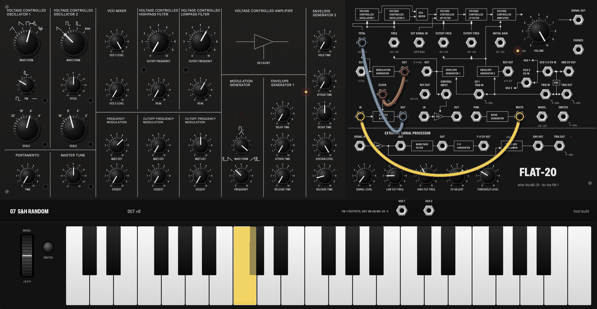

# FLAT-20 Panel (macOS)

<p align="center"></p>

A macOS companion app that displays the FM-1's current FLAT-20 state as an interactive MS-20 front panel over USB MIDI. It shows all knob positions, patch cables, panel wiring diagrams, active key, mod wheel, momentary switch, and LEDs, and lets you patch cables with the mouse.

## Patching with the mouse

- **Connect two jacks:** Click one jack, then click another. Any pair works—output to input, input to input, or output to output—and the FM-1 resolves the circuit exactly like a real patch panel (see `docs/MS20-CIRCUIT.md`, "Patch panel wiring").
- **Move or replace a cable:** Clicking a jack that already has a cable unplugs it first. If it's your first click, you start a new cable from that jack; if it's your second click, the existing cable is removed and the new one plugs in.
- **Remove a cable:** Click directly on a cable to unplug both ends.
- **Dummy plug (break normalled connection):** Option-click an empty jack to insert a dummy plug (unconnected at the other end). This opens the jack's switching contact and leaves the input at its internal pull-up/pull-down (e.g., a dummy plug in `TRIG IN` disconnects the keyboard trigger). Option-clicking an occupied jack unplugs it.
- **Cancel:** Click the same jack twice, click empty panel space, or press `Esc` to drop an in-progress cable (any cable already unplugged by the first click stays unplugged).

Like the hardware MS-20, each jack holds at most one plug.

The app only sends cable changes; knobs and switches are controlled exclusively on the FM-1. Sending cables requires a FLAT-20 0.2 build with cable-receive support; older firmware works in display-only mode.

## Build and run

```sh
mac/build.sh                         # builds mac/build/FLAT-20 Panel.app (ad-hoc signed for local use)
open "mac/build/FLAT-20 Panel.app"
```

Connect the FM-1 over USB (running FLAT-20 0.2 or later). The panel populates within a second and dims automatically if no state packets arrive for 2.5 seconds. External MIDI keyboards connected to the FM-1's TRS MIDI IN or routed through macOS work normally—the FM-1 always reports its own live state.

## Protocol

The firmware broadcasts its state via USB MIDI SysEx (`firmware/src/ms20_link.h`):

- **`STATE`:** All 36 knobs/switches, 8 patch cables, preset index, hold state, and octave. Sent on any change and as a 1 Hz heartbeat.
- **`LIVE`:** Active key, mod wheel, momentary switch, and LEDs. Sent on change.
- **`CABLES` (Mac → FM-1):** Sent when you edit cables in the app. Contains the full 8-cable patch table. The firmware validates every jack ID and ensures no input has duplicate cables, applies the patch, and reflects it in the next `STATE` message (~5 ms round-trip).

The app listens on all CoreMIDI sources for packets matching the FLAT-20 SysEx header. If the firmware's parameter or jack layout doesn't match the app's version, the window displays a mismatch notice instead of rendering garbage.

## Running without an FM-1

```sh
# Run the host firmware build and stream SysEx over a virtual MIDI port (cycles through presets)
python3 tools/fake_fm1.py
python3 tools/fake_fm1.py --loop

# Render a panel PNG offline from build/host/flat20 log output
cd mac && swift run panel-render out.png LOG [MS]

# Save a screenshot of the running app every 2 seconds
FLAT20_SNAPSHOT=/tmp/p "mac/build/FLAT-20 Panel.app/Contents/MacOS/FLAT-20 Panel"

# Script mouse clicks on jacks/cables (prefix din:/dout: for Option-click)
FLAT20_CLICKS="out:white in:shIn cable:0 din:trig" ...
```

## Layout and codegen

- `Sources/FlatPanelUI/Layout.swift`: Knob coordinates were measured from a perspective-corrected frontal photo of an original MS-20; the patch panel layout was measured from an MS-20 mini. Normalled signal-flow arrows were verified against photos of an original MS-20 and a full-size reissue. All graphics are drawn procedurally with no Korg trademarks or logos. `VCO 1 OUT` and `VCO 2 OUT` (which don't exist on the hardware) appear in the bottom strip.
- `Sources/FlatLink/Generated.swift`: Auto-generated from `firmware/src/ms20.h` by `tools/gen_link_swift.py`. `tests/run_tests.sh` verifies that it stays in sync.
